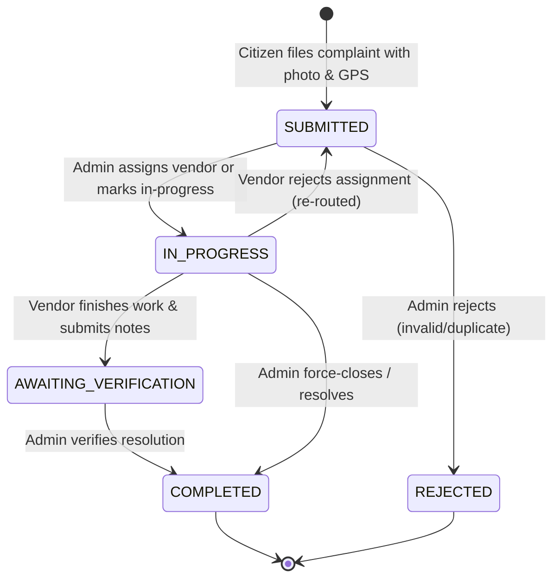
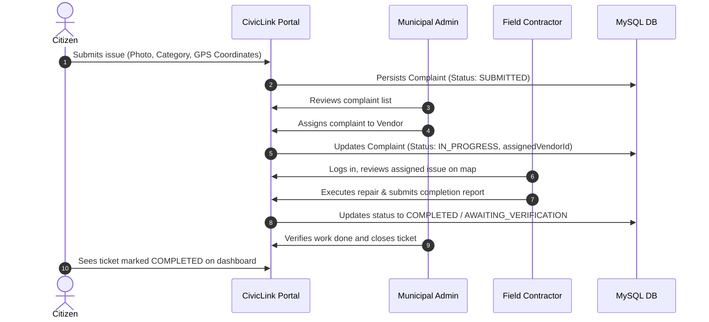

# 🏛️ CivicLink (CIVILINK)

<p align="center">
  
</p>

<p align="center">
  <strong>Empowering Citizen Grievance Redressal & Municipal Workflow Automation</strong>
</p>

<p align="center">
  <a href="#-overview"></a>
  <a href="https://spring.io/projects/spring-boot"></a>
  <a href="https://www.oracle.com/java/"></a>
  <a href="https://www.mysql.com/"></a>
  <a href="https://leafletjs.com/"></a>
  <a href="https://tailwindcss.com/"></a>
</p>

---

## 📑 Table of Contents
- [Overview](#-overview)
- [Key Features](#-key-features)
- [System Architecture & Workflow](#-system-architecture--workflow)
- [Technology Stack](#-technology-stack)
- [Project Structure](#-project-structure)
- [Database Schema](#-database-schema)
- [Getting Started](#-getting-started)
  - [Prerequisites](#prerequisites)
  - [Database Setup](#1-database-setup)
  - [Configuration](#2-configuration)
  - [Run the Application](#3-run-the-application)
- [Default Portals & Demo Credentials](#-default-portals--demo-credentials)
- [API & Route Directory](#-api--route-directory)
- [Troubleshooting & FAQ](#-troubleshooting--faq)
- [Roadmap](#-roadmap)
- [License](#-license)

---

## 🌟 Overview

**CivicLink** is a modern, full-stack civic grievance redressal and municipal maintenance workflow management system. Designed for smart cities and local civic bodies (such as municipal corporations), CivicLink bridges the gap between citizens, municipal administrators, and field contractors.

Citizens can document municipal infrastructure issues (such as potholes, overflowing garbage bins, water leaks, or defunct streetlights) with geo-coordinates and photographic evidence. Administrators triage and dispatch work orders to contractors, who update progress in real-time until final verification and resolution.

---

## ✨ Key Features

### 👤 Citizen Portal
* **Multiple Auth Methods**: Traditional password registration/login alongside one-click **Google Sign-In (OAuth 2.0 / Google Identity Services)**.
* **Geotagged Issue Filing**: Automated browser geolocation (latitude & longitude) extraction with manual address fallback.
* **Photo Proof Upload**: Multipart image attachment with server-side validation and static resource serving.
* **Live Personal Dashboard**: Real-time status counter (Total, In-Progress, Solved) and chronological complaint timeline.
* **Complaint Tracking**: Detailed per-complaint view showing administration notes, category tags, and current lifecycle stage.

### 🏛️ Municipal Administrator Portal (`/admin`)
* **Centralized Triage Queue**: Sort and inspect all municipal complaints submitted across city wards.
* **Direct Vendor Assignment**: Route issues to certified vendors/contractors based on problem domain.
* **Review & Verification**: Approve submitted complaints, add administrative notes, reject spurious complaints, or verify vendor completion.

### 🛠️ Vendor / Contractor Portal (`/vendor`)
* **Dedicated Contractor Authentication**: Lightweight vendor ID login system for field engineers and contractors.
* **Task Management**: Filtered assignment queue containing only tasks assigned to the authenticated contractor.
* **Field Updates**: Contractors can accept work orders, reject assignments with explanations, or submit resolution notes upon completion.

### 🌍 Public Transparency Dashboard (`/public`)
* **Interactive Map Visualization**: OpenStreetMap integration via **Leaflet.js** displaying geo-markers for public complaints.
* **Category Breakdown Cards**: Dynamic counters aggregating issues across categories (`GARBAGE`, `POTHOLE`, `STREETLIGHT`, `WATER_LEAK`, `NOISE`, `OTHER`).
* **Open REST Endpoint**: Real-time `/public/complaints.json` endpoint powering civic analytics.

---

## 🔄 System Architecture & Workflow

### Complaint Lifecycle State Machine



### Citizen to Vendor Sequence



---

## 💻 Technology Stack

| Layer | Technologies |
| :--- | :--- |
| **Backend Framework** | Java 17, Spring Boot 3.5.7 (Spring MVC, Spring Data JPA) |
| **Template Engine** | Thymeleaf 3.x with layout dialect |
| **Database & ORM** | MySQL 8.x, Hibernate 6.x |
| **Frontend Styling** | Tailwind CSS (CDN), Google Inter Font, Canvas Particle/Street Animation |
| **Mapping & Geospatial** | Leaflet.js 1.9.4, OpenStreetMap Tile Provider, HTML5 Geolocation API |
| **Authentication** | Spring HTTP Sessions, Google OAuth 2.0 (Google Identity Services & Nimbus JOSE JWT) |
| **Build & Tooling** | Apache Maven 3.x, Maven Wrapper (`mvnw`) |

---

## 📂 Project Structure

```text
CivicLink/
├── pom.xml                               # Maven project dependencies and build configuration
├── mvnw / mvnw.cmd                       # Maven wrapper executables
├── uploads/                              # Uploaded complaint photo attachments directory
└── src/
    └── main/
        ├── java/com/demo/demo/
        │   ├── DemoApplication.java      # Spring Boot application entry point
        │   ├── config/
        │   │   └── WebConfig.java        # Resource handler for /uploads/** mapping
        │   ├── controller/
        │   │   ├── AdminAuthController.java   # Admin login and session termination
        │   │   ├── AdminController.java       # Admin triage, assign, reject, and verify
        │   │   ├── AuthenticationController.java # Citizen login, registration, and Google auth
        │   │   ├── ComplaintController.java   # Complaint creation form and file upload
        │   │   ├── DashboardController.java   # Citizen personal dashboard
        │   │   ├── OAuthController.java       # Google OAuth 2.0 authorization & callback
        │   │   ├── PublicController.java      # Public open dashboard and JSON feed
        │   │   └── VendorController.java      # Vendor login, task acceptance, and closure
        │   ├── dto/
        │   │   └── PublicComplaintDto.java    # Sanitized DTO for public Leaflet map
        │   ├── model/
        │   │   ├── Complaint.java             # Complaint entity with geolocation and photo
        │   │   ├── ComplaintCategory.java     # Enums: GARBAGE, POTHOLE, STREETLIGHT, etc.
        │   │   ├── ComplaintStatus.java       # Enums: SUBMITTED, IN_PROGRESS, COMPLETED, etc.
        │   │   ├── User.java                  # Registered citizen entity (Local + Google)
        │   │   └── Vendor.java                # Registered municipal contractor entity
        │   ├── repo/
        │   │   ├── ComplaintRepository.java   # JPA repository with custom queries & counts
        │   │   ├── UserRepository.java        # User lookup by email/username
        │   │   └── VendorRepository.java      # Vendor data repository
        │   └── service/
        │       ├── ComplaintService.java      # Core grievance lifecycle & file I/O logic
        │       ├── GoogleOAuthService.java    # OAuth code exchange and user info fetching
        │       ├── UserService.java           # User registration and authentication
        │       └── VendorService.java         # Vendor assignment and completion workflows
        └── resources/
            ├── application.properties         # Database connection, file paths, OAuth keys
            ├── static/                        # Logos (civiclink.png, bmc.png) and assets
            └── templates/                     # Thymeleaf HTML views
                ├── login.html                 # Citizen login view
                ├── register.html              # Citizen registration view
                ├── dashboard.html             # Citizen dashboard & complaint list
                ├── complaint_new.html         # Grievance lodgement with map & photo
                ├── complaint-details.html     # Citizen complaint inspection
                ├── public_dashboard.html      # Public OpenStreetMap grievance map
                ├── admin/
                │   ├── login.html             # Admin portal login
                │   ├── complaints_list.html   # Admin triage view
                │   ├── complaint_view.html    # Detailed admin review
                │   └── assign.html            # Contractor assignment dialog
                └── vendor/
                    ├── login.html             # Vendor ID login
                    ├── complaints_list.html   # Assigned work queue
                    ├── complaint_view.html    # Task inspection & completion form
                    └── dashboard.html         # Vendor dashboard
```

---

## 🗄️ Database Schema

### Core Tables

1. **`users`**
   - `u_id` (PK, Auto-increment)
   - `u_username` (Unique), `u_email` (Unique), `u_password` (Hash/Text), `u_number`
   - `google_id`, `picture_url`, `email_verified`

2. **`complaints`**
   - `c_id` (PK, Auto-increment)
   - `u_id` (FK to `users`)
   - `c_category` (`GARBAGE`, `POTHOLE`, `STREETLIGHT`, `WATER_LEAK`, `NOISE`, `OTHER`)
   - `c_desc` (Text, up to 2000 chars)
   - `c_photo` (Relative URI path e.g. `/uploads/filename.jpg`)
   - `c_location` (Human-readable landmark/address)
   - `c_loc_desc` (Specific location directions)
   - `latitude`, `longitude` (Double coordinates for Leaflet mapping)
   - `c_status` (`SUBMITTED`, `IN_PROGRESS`, `AWAITING_VERIFICATION`, `COMPLETED`, `REJECTED`)
   - `admin_notes`, `vendor_notes`
   - `assigned_vendor_id` (FK/ID reference to `vendors`)
   - `created_at` (Timestamp)

3. **`vendors`**
   - `id` (PK, Auto-increment)
   - `name`, `contact_number`, `email`, `active`

---

## 🚀 Getting Started

### Prerequisites
* **Java Development Kit (JDK)**: Version 17 or higher (`java -version`)
* **MySQL Database Server**: Version 8.0+ running on port `3306`
* **Git**: To clone and manage the repository

### 1. Database Setup
Log into your MySQL CLI or GUI client (Workbench, DBeaver) and create the database:

```sql
CREATE DATABASE complaint_portal CHARACTER SET utf8mb4 COLLATE utf8mb4_unicode_ci;
```

*(Hibernate will automatically create and update the table structures upon initial application startup due to `spring.jpa.hibernate.ddl-auto=update`.)*

### 2. Configuration
Open `src/main/resources/application.properties` and customize your local credentials:

```properties
# MySQL Database Connection
spring.datasource.url=jdbc:mysql://localhost:3306/complaint_portal?useSSL=false&serverTimezone=UTC
spring.datasource.username=root
spring.datasource.password=your_mysql_password

# Hibernate Configuration
spring.jpa.hibernate.ddl-auto=update
spring.jpa.show-sql=true
spring.jpa.properties.hibernate.format_sql=true

# Uploads Directory (Relative to project root or absolute path)
file.upload-dir=uploads
spring.servlet.multipart.max-file-size=5MB
spring.servlet.multipart.max-request-size=10MB

# Google OAuth 2.0 Configuration (Optional / Dev)
google.oauth.client-id=YOUR_GOOGLE_CLIENT_ID.apps.googleusercontent.com
# google.oauth.client-secret=YOUR_GOOGLE_CLIENT_SECRET
google.oauth.redirect-uri=http://localhost:8080/oauth2/callback/google
app.base-url=http://localhost:8080
```

> **Note on Uploads Directory**: Ensure an `uploads/` directory exists in the project root:
> ```bash
> mkdir -p uploads
> ```

### 3. Run the Application

Using the bundled Maven wrapper:

#### On macOS / Linux:
```bash
./mvnw clean spring-boot:run
```

#### On Windows (PowerShell / Command Prompt):
```cmd
mvnw.cmd clean spring-boot:run
```

Once the application logs show `Started DemoApplication in ... seconds`, navigate to:
👉 **`http://localhost:8080`**

---

## 🔑 Default Portals & Demo Credentials

| Portal | URL Path | Login Method / Credentials | Notes |
| :--- | :--- | :--- | :--- |
| **Citizen Portal** | `/` or `/login` | Register new user or Google Sign-In | Citizen complaint submission & tracking |
| **Public Dashboard** | `/public/dashboard` | Public access (No login needed) | OpenStreetMap live complaint pins |
| **Admin Portal** | `/admin/login` | **Username**: `admin`<br/>**Password**: `admin` | Triage, assignment, and approvals |
| **Vendor Portal** | `/vendor/login` | **Vendor ID**: Numeric ID (e.g. `1`) | Requires seed entry in `vendors` table |

### Seeding a Sample Vendor (Optional)
To test the vendor workflow, execute the following SQL in your `complaint_portal` database:

```sql
INSERT INTO vendors (name, contact_number, email, active) 
VALUES ('Apex Civic Works Ltd.', '+91-9876543210', 'contractor@apexcivic.com', 1);
```
*You can now log in at `/vendor/login` using **Vendor ID**: `1`.*

---

## 📡 API & Route Directory

### Citizen & Public Routes
| Method | Endpoint | Description |
| :--- | :--- | :--- |
| `GET` | `/` or `/login` | Citizen login page with Google Sign-In integration |
| `POST` | `/login` | Authenticate citizen credentials |
| `GET` | `/register` | Citizen registration page with resolution statistics |
| `POST` | `/register` | Register citizen account |
| `GET` | `/logout` | Invalidate current user session |
| `GET` | `/dashboard` | Citizen personal dashboard & complaint list |
| `GET` | `/complaints/new` | Multi-field complaint creation form |
| `POST` | `/complaints` | Submit new grievance with multipart image attachment |
| `GET` | `/complaints/{id}` | View detailed complaint status & admin response |
| `GET` | `/public/dashboard`| Public Leaflet map & category summary cards |
| `GET` | `/public/complaints.json` | JSON feed returning top 50 recent geolocated complaints |

### Admin Routes (`/admin`)
| Method | Endpoint | Description |
| :--- | :--- | :--- |
| `GET` | `/admin/login` | Administrator authentication view |
| `POST` | `/admin/login` | Process administrator sign-in |
| `GET` | `/admin/logout` | Administrator sign-out |
| `GET` | `/admin/complaints` | All complaints queue (sorted newest first) |
| `GET` | `/admin/complaints/{id}` | Inspect specific grievance & take action |
| `POST` | `/admin/complaints/{id}/approve` | Mark status as `IN_PROGRESS` with optional notes |
| `POST` | `/admin/complaints/{id}/reject` | Reject complaint with justification reason |
| `GET` | `/admin/complaints/{id}/assign` | View list of active vendors for assignment |
| `POST` | `/admin/complaints/{id}/assign` | Assign vendor to complaint |
| `POST` | `/admin/complaints/{id}/complete`| Force-close or confirm resolution of complaint |

### Vendor Routes (`/vendor`)
| Method | Endpoint | Description |
| :--- | :--- | :--- |
| `GET` | `/vendor/login` | Contractor login portal |
| `POST` | `/vendor/login` | Authenticate using Vendor ID |
| `GET` | `/vendor/logout` | End vendor session |
| `GET` | `/vendor/complaints` | List tasks assigned to this vendor |
| `GET` | `/vendor/complaints/{id}`| Inspect assigned task details |
| `POST` | `/vendor/complaints/{id}/accept` | Accept assigned work order |
| `POST` | `/vendor/complaints/{id}/reject` | Reject work order (resets status to `SUBMITTED`) |
| `POST` | `/vendor/complaints/{id}/complete`| Submit resolution notes upon completing repair |

---

## 🛠️ Troubleshooting & FAQ

### 1. MySQL Connection Refused
* **Issue**: `CommunicationsException: Communications link failure`.
* **Fix**: Ensure your MySQL server service is started (`sudo service mysql start` or through Docker) and that the database `complaint_portal` is created before starting the application.

### 2. Uploaded Photos Return 404
* **Issue**: Complaint images saved under `/uploads/...` are not rendering in the browser.
* **Fix**: Ensure the directory named `uploads/` exists in your working root directory. The `WebConfig.java` class maps `/uploads/**` to this filesystem path.

### 3. Google OAuth Redirect Mismatch
* **Issue**: `redirect_uri_mismatch` error from Google.
* **Fix**: Ensure the Authorized Redirect URI in your [Google Cloud Console](https://console.cloud.google.com/) exactly matches `http://localhost:8080/oauth2/callback/google`.

---

## 🗺️ Roadmap

- [ ] **SMS & Email Alerts**: Integrate Twilio or SendGrid for real-time status updates to citizens.
- [ ] **Role-Based Spring Security**: Migrate session-based auth to comprehensive Spring Security 6 with JWT and BCrypt password encryption.
- [ ] **AI-Powered Image Triage**: Automated duplicate detection and priority scoring using computer vision.
- [ ] **SLA & Escalation Timers**: Automated escalation to senior municipal officers if issues remain unattended past deadlines.
- [ ] **Mobile Citizen App**: React Native or Flutter mobile client for on-the-go reporting with offline caching.

---

## 📄 License

This project is licensed under the [MIT License](LICENSE) — feel free to use and customize it for educational, commercial, or municipal purposes.

<p align="center">
  Built with ❤️ to improve civic transparency and public infrastructure.
</p>
